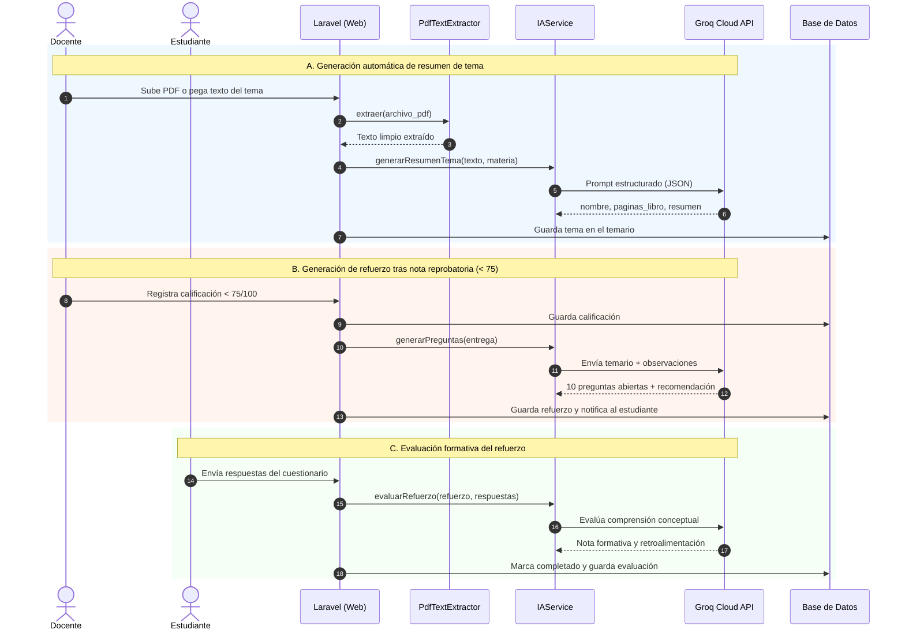

# Plataforma Académica Preuniversitaria — Carrera de Psicología (UPEA)

Sistema web integral de gestión académica, seguimiento pedagógico personalizado, biblioteca digital, evaluación continua y refuerzo educativo asistido por **Inteligencia Artificial (Groq Cloud)** y notificaciones asíncronas vía **Telegram**.

---

## Requisitos de Hardware (Servidor VPS)

El dimensionamiento del servidor depende de la cantidad de usuarios concurrentes (estudiantes, docentes y administrativos) y de si se ejecuta el microservicio opcional de Machine Learning (Python) o la compilación de frontend (`npm run build`) en el mismo VPS.

| Perfil de Despliegue | Usuarios Concurrentes | CPU (vCPU) | Memoria RAM | Almacenamiento (SSD/NVMe) | Swap Recomendada |
| :--- | :--- | :--- | :--- | :--- | :--- |
| **Mínimo (Pruebas / Piloto)** | Hasta 40 | 1 – 2 vCPU | 2 GB | 20 GB SSD | 2 GB |
| **Recomendado (Producción)** | 50 – 250 | 2 – 4 vCPU | 4 GB | 40 – 60 GB NVMe | 2 GB |
| **Alta Demanda (Exámenes / Inscripciones)** | 250 – 600+ | 4 – 8 vCPU | 8 GB | 80 – 120 GB NVMe | 2 – 4 GB |

### Desglose estimado de consumo de RAM en producción
- **Sistema Operativo (Ubuntu Server 22.04 / 24.04 LTS):** ~250 – 350 MB
- **Nginx (servidor web + proxy inverso SSL):** ~30 – 80 MB
- **PHP-FPM 8.2/8.3 (pool de workers + DomPDF + importación Excel):** ~400 MB – 1.2 GB
- **MySQL 8.0 / MariaDB 10.6+:** ~400 MB – 1.5 GB (según `innodb_buffer_pool_size`)
- **Laravel Queue Worker (Supervisor para Telegram):** ~60 – 120 MB
- **Microservicio Python ML (opcional, Flask + scikit-learn):** ~250 – 500 MB
- **Compilación Vite (`npm run build`):** pico temporal de ~800 MB – 1.5 GB (por esto se recomienda al menos **2 GB de Swap** si el VPS tiene 2 GB de RAM).

### Consideraciones de Almacenamiento
- La plataforma almacena **libros y guías PDF**, **materiales de lecciones y recursos** (hasta 50 MB por archivo), **entregas de estudiantes** (hasta 25 MB por archivo), **portadas**, **convocatorias** y **respaldos diarios de base de datos**.
- Se recomienda mantener siempre al menos **30% de espacio libre en disco** y activar rotación diaria de logs (`LOG_STACK=daily`).

---

## Requisitos de Software

### Servidor de Producción (VPS Linux — Ubuntu 22.04 / 24.04 LTS recomendado)
- **PHP:** `>= 8.2` (recomendado `8.3`) con extensiones:
  `pdo_mysql`, `mbstring`, `xml`, `bcmath`, `curl`, `zip`, `gd` (o `imagick`), `fileinfo`, `intl`, `openssl`, `tokenizer`, `ctype`
- **Base de Datos:** MySQL `8.0+` o MariaDB `10.6+`
- **Servidor Web:** Nginx `1.18+` (o Caddy/Apache) con certificado **SSL/HTTPS** (Let's Encrypt / Certbot)
- **Gestor de Dependencias PHP:** Composer `2.x`
- **Entorno Node.js (para compilación de assets):** Node.js `20 LTS+` y NPM `10+`
- **Gestor de Procesos en Segundo Plano:** `supervisor` (para el worker de colas de Telegram)
- **Opcional — Extracción avanzada de PDF:** `poppler-utils` (`pdftotext`)
- **Opcional — Servicio Predictivo ML:** Python `3.10+` (`flask`, `scikit-learn`)

---

## Stack Tecnológico

### Backend
- **Laravel 12.x** sobre **PHP 8.2 / 8.3+**
- **Eloquent ORM** con `SoftDeletes` (papelera de reciclaje y restauración) y caché de configuración global
- **Spatie Laravel-Permission** para control de acceso por roles (`admin`, `docente`, `estudiante`, `administrativo`)
- **Laravel Queues (`database`)** para envío asíncrono de notificaciones por Telegram
- **Barryvdh DomPDF** para reportes y actas en PDF
- **Maatwebsite Excel** para importación masiva de estudiantes y exportación de sábanas de calificaciones
- **Ofuscación de IDs (`IdObfuscator`)** en URLs públicas para evitar exposición de IDs secuenciales

### Frontend (SPA)
- **Inertia.js v2** + **React 19** + **TypeScript**
- **Tailwind CSS v4** + **Radix UI** + **Lucide React** + **Framer Motion** + **Sonner**
- **Vite 6** para compilación optimizada de producción

### Inteligencia Artificial, ML y Mensajería
- **Groq Cloud API** (modelos LLM con salida en JSON estructurado):
  - Resumen automático de temarios desde PDF o texto.
  - Sugerencia de retroalimentación pedagógica para docentes.
  - Generación y evaluación formativa de cuestionarios de refuerzo (para notas `< 75/100`).
- **Microservicio Machine Learning (opcional):** predicción de rendimiento y recomendación preventiva de lectura.
- **Telegram Bot API:** webhook bidireccional con vinculación por Cédula de Identidad (CI) + verificación de contacto telefónico.

---

## Arquitectura de Módulos

| Módulo | Función Principal | Controladores / Servicios |
| :--- | :--- | :--- |
| **Portal Público (`Welcome`)** | Portadas animadas, misión/visión, convocatorias con lightbox, biblioteca digital en carrusel con visor PDF y autoridades. | `routes/web.php`, `PaginaAdminController` |
| **Gestión Académica** | Gestiones, paralelos/cursos, materias, docentes, estudiantes, administrativos y roles. | `GestionController`, `CursoController`, `MateriaController`, `DocenteController`, `EstudianteController`, `AdministrativoController`, `RoleController` |
| **Temarios y Recursos** | Planificación por temas con resúmenes asistidos por IA desde PDF y materiales de apoyo. | `TemaController`, `RecursoController`, `IAService`, `PdfTextExtractor` |
| **Lecciones y Entregas** | Tareas con fecha/hora límite exacta, subida validada de archivos y seguimiento de cumplimiento. | `LeccionController`, `EntregaController` |
| **Calificaciones y Refuerzo IA** | Registro de notas, retroalimentación sugerida y cuestionarios de refuerzo personalizados. | `CalificacionController`, `RefuerzoController`, `IAService` |
| **Biblioteca Digital** | Administración de libros y guías oficiales en PDF con portada y lectura integrada. | `LibroController` |
| **Importación y Reportes** | Carga masiva de estudiantes desde Excel y exportación de reportes académicos en PDF/Excel. | `ImportController`, `ReporteController` |
| **Notificaciones y Telegram** | Campanita web interna + envío asíncrono por bot de Telegram. | `NotificacionController`, `NotificacionService`, `TelegramWebhookController`, `TelegramConfigController` |
| **Recomendaciones ML** | Análisis preventivo del siguiente tema según historial de notas. | `RecomendacionController`, `MachineLearningService` |

---

## Flujos Principales del Sistema

### 1. Procesamiento Pedagógico con IA (Groq Cloud)



### 2. Vinculación y Notificaciones vía Telegram

```mermaid
flowchart TD
    subgraph S1 [1. Vinculación de Cuenta]
        A[Usuario abre el Bot en Telegram] --> B[Envía /start]
        B --> C[POST /telegram/webhook]
        C --> D{¿Telegram Activo?}
        D -- No --> E[Ignora evento]
        D -- Sí --> F[Bot solicita CI]
        F --> G[Usuario ingresa su CI]
        G --> H[Bot pide botón 'Compartir Contacto']
        H --> I{¿Celular coincide con BD?}
        I -- No --> J[Rechaza vinculación]
        I -- Sí --> K[Guarda chat_id en telegram_vinculacions]
    end

    subgraph S2 [2. Despacho Asíncrono]
        L[Evento Académico] --> M[NotificacionService::crear]
        M --> N[(Tabla notificaciones)]
        M --> O[Job EnviarNotificacionTelegram]
        O --> P[Queue Worker / Supervisor]
        P --> Q{¿Usuario vinculado?}
        Q -- Sí --> R[Telegram Bot API sendMessage]
    end
```



---

## Guía de Instalación y Despliegue en Producción (VPS)

### 1. Clonar el repositorio e instalar dependencias
```bash
git clone <URL_DEL_REPOSITORIO> proyecto_psicologia
cd proyecto_psicologia

composer install --no-dev --optimize-autoloader
npm ci
npm run build
```

### 2. Configurar variables de entorno (`.env`)
Copia la plantilla y edita las credenciales reales del servidor:
```bash
cp .env.example .env
php artisan key:generate
```

Ejemplo de configuración recomendada para **producción**:
```env
APP_NAME="Preuniversitario Psicología UPEA"
APP_ENV=production
APP_DEBUG=false
APP_TIMEZONE=America/La_Paz
APP_URL=https://tu-dominio.com

APP_LOCALE=es
APP_FALLBACK_LOCALE=es

LOG_CHANNEL=stack
LOG_STACK=daily
LOG_LEVEL=warning

DB_CONNECTION=mysql
DB_HOST=127.0.0.1
DB_PORT=3306
DB_DATABASE=preuniversitario_psicologia
DB_USERNAME=tu_usuario_mysql
DB_PASSWORD=tu_password_seguro

SESSION_DRIVER=database
SESSION_LIFETIME=120
SESSION_ENCRYPT=true
SESSION_SECURE_COOKIE=true

QUEUE_CONNECTION=database
CACHE_STORE=database

# Inteligencia Artificial (Groq Cloud)
GROQ_API_KEY=gsk_REEMPLAZAR_CON_TU_CLAVE_REAL
GROQ_MODEL=openai/gpt-oss-20b

# Bot de Telegram (obtener token en @BotFather; nunca subir tokens reales al repositorio)
TELEGRAM_ENABLED=true
TELEGRAM_BOT_TOKEN=REEMPLAZAR_CON_TU_TOKEN_DE_BOTFATHER

# Microservicio Python ML (opcional)
ML_SERVICE_URL=http://127.0.0.1:5000
```

### 3. Base de datos, almacenamiento y cachés de Laravel
```bash
php artisan migrate --force
php artisan storage:link
php artisan optimize
```

Permisos recomendados (usuario web `www-data`):
```bash
sudo chown -R www-data:www-data storage bootstrap/cache
sudo chmod -R 775 storage bootstrap/cache
```

### 4. Configuración recomendada de PHP y Nginx

**PHP (`php.ini` de `php-fpm`):**
```ini
upload_max_filesize = 55M
post_max_size = 60M
memory_limit = 256M
max_execution_time = 120
```

**Nginx (bloque `server`):**
```nginx
client_max_body_size 60M;

# Bloquear ejecución de PHP dentro de archivos subidos
location ^~ /storage/ {
    location ~ \.php$ {
        deny all;
    }
}

location ~ \.php$ {
    fastcgi_pass unix:/run/php/php8.3-fpm.sock;
    fastcgi_read_timeout 120;
    fastcgi_param SCRIPT_FILENAME $realpath_root$fastcgi_script_name;
    include fastcgi_params;
}
```

### 5. Worker de colas con Supervisor (Telegram)
Crear `/etc/supervisor/conf.d/psicologia-worker.conf`:
```ini
[program:psicologia-worker]
process_name=%(program_name)s_%(process_num)02d
command=php /var/www/proyecto_psicologia/artisan queue:work database --sleep=3 --tries=3 --timeout=90
autostart=true
autorestart=true
user=www-data
numprocs=1
redirect_stderr=true
stdout_logfile=/var/www/proyecto_psicologia/storage/logs/worker.log
stopwaitsecs=3600
```

Activar Supervisor:
```bash
sudo supervisorctl reread
sudo supervisorctl update
sudo supervisorctl start psicologia-worker:*
```

### 6. Configurar Webhook de Telegram (requiere HTTPS activo)
Puede configurarse desde el panel administrativo (**Configuración → Telegram**) o mediante consola:
```bash
php artisan telegram:set-webhook
```

**Vinculación de estudiantes y docentes:**
1. Abrir el bot en Telegram y presionar **Iniciar** (`/start`).
2. Escribir su número de Cédula de Identidad (CI).
3. Presionar el botón **Compartir mi número** para verificar identidad y activar notificaciones.

---

## Actualización en Producción (Deploy)

Cada vez que se suban nuevos cambios al repositorio, ejecutar en el VPS:
```bash
git pull origin main
composer install --no-dev --optimize-autoloader
npm ci && npm run build
php artisan migrate --force
php artisan optimize:clear
php artisan optimize
sudo supervisorctl restart psicologia-worker:*
```

---

## Respaldo y Mantenimiento Recomendado

- **Base de datos (cron diario):** programar `mysqldump` comprimido con retención de 14 días fuera del servidor o en almacenamiento secundario.
- **Archivos subidos:** respaldar periódicamente `storage/app/public/` (libros PDF, portadas, convocatorias, materiales y entregas).
- **Monitoreo de colas:** verificar trabajos fallidos con `php artisan queue:failed`.

---

## Desarrollo Local y Pruebas

```bash
# Levantar servidor web, colas y Vite en desarrollo
composer run dev

# Ejecutar suite de pruebas automatizadas (Pest)
php artisan test --compact
```
