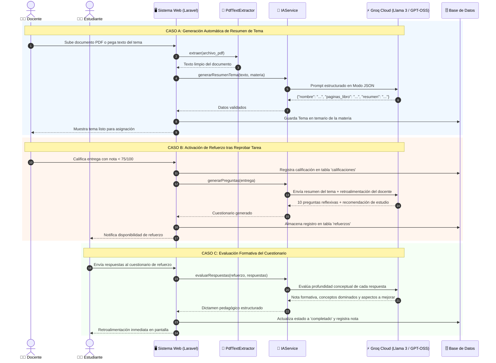

# 🧠 Plataforma Académica Preuniversitaria - Carrera de Psicología (UPEA)

Sistema integral de gestión académica, seguimiento pedagógico personalizado, evaluación continua y refuerzo educativo impulsado por **Inteligencia Artificial (IA)** y notificaciones asíncronas vía **Telegram**.

---

## 🚀 Tecnologías Modernas Utilizadas

El sistema está construido siguiendo las mejores prácticas de la industria con un stack tecnológico moderno y reactivo:

### 1. Backend & Arquitectura del Servidor
- **PHP 8.3+**: Tipado estricto, constructor property promotion, match expressions y optimizaciones JIT.
- **Laravel 11.x**:
  - Estructura minimalista moderna (`bootstrap/app.php` sin Kernels pesados).
  - **Eloquent ORM**: Relaciones complejas, SoftDeletes (papelera de reciclaje), Scopes de consulta y eventos.
  - **Laravel Queues & Asynchronous Jobs**: Procesamiento en segundo plano (`EnviarNotificacionTelegram`) con retraso inteligente para respetar los límites de tasa (*rate-limiting*) de la API de Telegram.
  - **Laravel Storage**: Gestión de almacenamiento público y privado para entregas de tareas, recursos pedagógicos y bibliografía en PDF.
  - **Spatie Laravel-Permission**: Control de acceso basado en roles (*RBAC*: `admin`, `docente`, `estudiante`, `administrativo`) y permisos granulares.
  - **Maatwebsite Excel**: Importación masiva de nóminas estudiantiles desde hojas de cálculo Excel con previsualización reactiva de errores y generación de credenciales temporales.
  - **Barryvdh DomPDF**: Generación y exportación de sábanas de notas oficiales y reportes de refuerzo con IA en formato PDF.
  - **IdObfuscator**: Cifrado reversible URL-safe basado en XOR y HMAC-SHA256 para proteger los IDs autonuméricos en rutas públicas.

### 2. Frontend Reactivo & Experiencia de Usuario (SPA)
- **Inertia.js v2**: Arquitectura Single Page Application (SPA) moderna que elimina la duplicidad de una API REST tradicional, enlazando directamente controladores de Laravel con componentes React sin perder hidratación de estado.
- **React 19 & TypeScript**: Tipado estático de interfaces (`Tema`, `Recurso`, `Leccion`, `Entrega`), componentes modulares y hooks reactivos.
- **Tailwind CSS**: Diseño adaptable y estilizado con identidad institucional de la carrera.
- **Lucide React**: Paquete de iconografía vectorial moderna para interfaces educativas.
- **Vite 5+**: Empaquetador ultrarrápido con Hot Module Replacement (HMR) para desarrollo y compilación optimizada para producción.

### 3. Inteligencia Artificial & Machine Learning
- **Groq LPU Inference Cloud**: Inferencia de modelos de lenguaje de última generación (*LLMs*) a velocidad récord (ultrabaja latencia) consumiendo modelos de código abierto como `llama-3.3-70b-versatile` y `gpt-oss-20b`.
- **Modo JSON Estructurado**: Garantiza que las respuestas de la IA respeten contratos de datos estrictos para títulos, resúmenes, preguntas abiertas y desgloses de evaluación.
- **Extractor Nativo de Texto PDF (`PdfTextExtractor`)**: Algoritmo en PHP puro con descompresión de flujos `FlateDecode` (`gzuncompress`) y soporte para binarios del sistema (`pdftotext`), extrayendo el contenido de temarios sin librerías pesadas externas.
- **Microservicio Machine Learning en Python**: Servicio Flask complementario (`scikit-learn`) que analiza el rendimiento del alumno para predecir retención académica y sugerir bibliografía preventiva.

### 4. Automatización & Mensajería Móvil
- **Telegram Bot API (Webhook + Criptografía SSL)**: Conexión bidireccional inmediata.
- **Mecanismo de Doble Factor de Vinculación**: Validación segura cruzando Cédula de Identidad (CI) con el botón nativo de Telegram `Compartir Contacto` verificado por el servidor.

---

## 📊 Flujos de Datos del Sistema

### 1. Flujo de Datos: Consultas y Procesamiento con IA (Groq)

El sistema integra la IA en tres momentos académicos fundamentales:
1. **Extracción y Resumen de Temas**: A partir de un PDF o texto ingresado por el docente, la IA genera el título normalizado, páginas de referencia y una sinopsis pedagógica.
2. **Generación de Refuerzo Personalizado**: Si un estudiante obtiene una calificación reprobatoria (< 75/100) en una tarea, la IA genera 10 preguntas reflexivas abiertas basadas en el temario y las debilidades observadas por el docente.
3. **Calificación Automática de Refuerzos**: Cuando el estudiante responde el cuestionario formativo, la IA evalúa la asimilación conceptual, pondera la nota y proporciona recomendaciones de superación.



---

### 2. Flujo de Datos: Notificaciones y Webhook de Telegram

El módulo de Telegram mantiene a la comunidad informada en tiempo real sin saturar los servidores de mensajería:

```mermaid
flowchart TD
    subgraph S1 [1. Vinculación de Seguridad del Usuario]
        A[Estudiante abre Telegram] --> B[Envía comando /start al Bot]
        B --> C[Telegram envía Webhook POST /telegram/webhook]
        C --> D{¿Telegram Activo en Config?}
        D -- No --> E[Ignorar evento]
        D -- Sí --> F[Bot solicita Cédula de Identidad CI]
        F --> G[Usuario escribe su CI]
        G --> H[Bot busca usuario y solicita botón 'Compartir Contacto']
        H --> I[Usuario presiona 'Compartir Número']
        I --> J{¿Coincide número con BD?}
        J -- No --> K[Mensaje: Número no autorizado]
        J -- Sí --> L[Guarda Chat ID en telegram_vinculacions]
        L --> M[Mensaje: ¡Vinculación Exitosa!]
    end

    subgraph S2 [2. Despacho Asíncrono de Notificaciones]
        N[Evento en el Sistema: Tarea Calificada / Nuevo Recurso] --> O[NotificacionService::crear]
        O --> P[(Guarda en BD: notificaciones)]
        P --> Q[Campanita Web se actualiza]
        O --> R[EnviarNotificacionTelegram::dispatch]
        R --> S[Cola de Trabajos Queue con Delay de 1s]
        S --> T[Worker procesa Job]
        T --> U{¿Usuario Vinculado a Telegram?}
        U -- No --> V[Finaliza Job]
        U -- Sí --> W[Petición HTTP a api.telegram.org/sendMessage]
        W --> X[Notificación Push en el Celular del Usuario]
    end
```



---

## 📂 Arquitectura de Módulos del Proyecto

| Módulo | Descripción | Controladores & Servicios |
| :--- | :--- | :--- |
| **Temarios & IA** | Estructuración curricular por materia. Creación asistida por IA extrayendo resúmenes desde PDFs. | [`TemaController`](file:///d:/Carrera/exTRAS/SFTP_psicologia_tesis/app/Http/Controllers/TemaController.php), [`IAService`](file:///d:/Carrera/exTRAS/SFTP_psicologia_tesis/app/Services/IAService.php), [`PdfTextExtractor`](file:///d:/Carrera/exTRAS/SFTP_psicologia_tesis/app/Services/PdfTextExtractor.php) |
| **Recursos de Estudio** | Materiales de apoyo (PDFs, enlaces YouTube, lecturas externas) organizados por tema, independientes de las tareas. | [`RecursoController`](file:///d:/Carrera/exTRAS/SFTP_psicologia_tesis/app/Http/Controllers/RecursoController.php), [`Recurso`](file:///d:/Carrera/exTRAS/SFTP_psicologia_tesis/app/Models/Recurso.php) |
| **Lecciones & Tareas** | Asignaciones académicas con fecha límite, ponderación y gestión de entregas de archivos. | [`LeccionController`](file:///d:/Carrera/exTRAS/SFTP_psicologia_tesis/app/Http/Controllers/LeccionController.php), [`EntregaController`](file:///d:/Carrera/exTRAS/SFTP_psicologia_tesis/app/Http/Controllers/EntregaController.php) |
| **Calificaciones & Refuerzo** | Evaluación de tareas con sugerencia de retroalimentación por IA y generación de cuestionarios adaptativos. | [`CalificacionController`](file:///d:/Carrera/exTRAS/SFTP_psicologia_tesis/app/Http/Controllers/CalificacionController.php), [`RefuerzoController`](file:///d:/Carrera/exTRAS/SFTP_psicologia_tesis/app/Http/Controllers/RefuerzoController.php) |
| **Notificaciones & Telegram** | Sistema de mensajería asíncrono con jobs encolados y sincronización móvil. | [`TelegramWebhookController`](file:///d:/Carrera/exTRAS/SFTP_psicologia_tesis/app/Http/Controllers/Telegram/TelegramWebhookController.php), [`NotificacionService`](file:///d:/Carrera/exTRAS/SFTP_psicologia_tesis/app/Services/NotificacionService.php) |
| **Importación Masiva** | Procesamiento de nóminas estudiantiles desde Excel con validación de filas en tiempo real. | [`ImportController`](file:///d:/Carrera/exTRAS/SFTP_psicologia_tesis/app/Http/Controllers/ImportController.php) |
| **Reportes Académicos** | Generación de boletines, sábanas de calificaciones en Excel y actas de refuerzo en PDF. | [`ReporteController`](file:///d:/Carrera/exTRAS/SFTP_psicologia_tesis/app/Http/Controllers/ReporteController.php) |

---

## ⚙️ Guía de Despliegue y Puesta en Marcha

### 1. Variables de Entorno (`.env`)
Configurar en el servidor de producción:
```env
APP_NAME="Preuniversitario Psicología UPEA"
APP_ENV=production
APP_DEBUG=false
APP_URL=https://pre-univ-psicologia.duckdns.org

# Configuración de Groq Cloud IA
GROQ_API_KEY=gsk_tu_clave_de_groq_aqui
GROQ_API_URL=https://api.groq.com/openai/v1/chat/completions
GROQ_MODEL=openai/gpt-oss-20b

# Configuración del Bot de Telegram
TELEGRAM_ENABLED=true
TELEGRAM_BOT_TOKEN="8674361430:AAEFMO0OpnDhFyikEcjUUYcYpMJiINPrlXE"

# Driver de Colas de Laravel
QUEUE_CONNECTION=database
```

### 2. Ejecutar Migraciones
Ejecutar las migraciones para aplicar los campos de PDF en temas y la nueva tabla de recursos de estudio:
```bash
php artisan migrate --force
```

### 3. Compilación de Activos Frontend
```bash
npm install
npm run build
```

### 4. Enlace Simbólico de Almacenamiento
```bash
php artisan storage:link
```

### 5. Registrar el Webhook de Telegram
```bash
php artisan telegram:set-webhook
```

### 6. Ejecución del Worker de Colas (Supervisor o Systemd)
Para el envío continuo de notificaciones de Telegram:
```bash
php artisan queue:work --tries=3 --timeout=90
```

